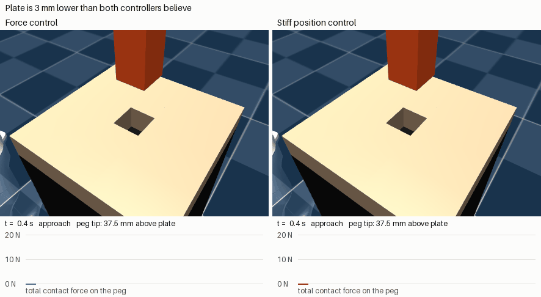
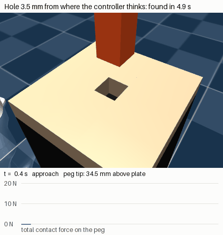

# franka-force-control

Torque-level force control on a simulated Franka Panda (MuJoCo), up to peg-in-hole with an unknown hole position, then tested against the mismatch a real robot would have. The controller is also ported to C++ with a measured 1 kHz loop.

Simulation only. This has never run on a real arm.



The plate above is 3 mm lower than either controller believes. Force control feels for it. Stiff position control spirals 2 mm above it and never touches anything.

## Main results

Peg 20 mm, hole 21 mm, no chamfer, 20 mm deep. The hole is 2 to 5 mm from where the controller thinks it is. 150 trials per row (50 seeds at each of 3 offsets), run once after settings were frozen.

| True plate height | Force control + spiral | Stiff position + spiral |
|---|---|---|
| 3 mm lower | 150 inserted, 14.5 N peak | **0 inserted**, never touches |
| As believed | 150 inserted, 14.5 N peak | 150 inserted, 17.5 N peak |
| 3 mm higher | 150 inserted, 14.6 N peak | 150 inserted, **52.4 N peak** |

If the height is right, stiff control ties. It's even slightly faster. Force feedback earns its keep when the height is uncertain.

Then with mismatch added (final controller, fresh seeds):

| Mismatch | Force control | Stiff position |
|---|---|---|
| Tool 0.5 kg lighter than believed | 90/90, 19 N | **0/90** |
| Joint friction 1 Nm | 84/90, 34 N | 77/90, **110 N** |
| Combined "realistic" set C- | 150/150, 19 N | 144/150, 53 N |
| F/T noise σ = 1 N | **80/90, 61 N** | 90/90, 18 N |
| Hole yawed 2° | 66/90 | 57/90 |

The last two rows are there on purpose. Stiff control doesn't read the sensor, so a bad sensor can't hurt it, and yaw 2° is hard for both because the search geometry stops covering the smaller opening.

## What I'd point out

**The robustness test found three bugs in my own design.** The perfect-model tests had passed. All three were invisible there.

1. The insert phase wasn't really force-controlled. A clamp on the position ramp left 2 N of push at the success depth, so a tool 0.2 kg too light plus a little friction stalled it at 16 mm. Removing just that clamp took three failing conditions from 0/5 to 5/5.
2. A fixed 1 N contact threshold on a sensor that can drift. A +2 N bias fired it in free air, and in the press task the controller then drove into the table at **199 N**. Fixed by tracking the free-space reading and calling contact only on a sustained rise above it.
3. The search-to-insert switch dropped the push from 5 N to 0 in one tick, so a light tool lifted back out of a hole it had already found. I'd already fixed this exact bug class in the first milestone and didn't carry it over. Fixing it has a cost: nominal peak force went from 14 N to 21 N.

**Force control swaps one sensitivity for another.** With a wrong payload, impedance control is off by 4.9 N while force control holds zero. With a biased sensor it's the reverse: force control inherits the bias one for one (before fix 2), and impedance doesn't care.

**A 0.6 mm drift nobody asked for.** Descending at k = 500, the tip drifts 0.59 mm sideways, more than the ±0.5 mm clearance, so even a perfectly placed peg clips the rim. It comes from Menagerie's joint damping, which the controller doesn't compensate. Zeroing the damping brings it to 0.036 mm.

## Bars that failed

Pass bars were written down before each run ([PLAN.md](PLAN.md) has them, plus the full log). These stayed failed:

- **M2 (a), rigid probe wiping:** contact chatter, 1.4 s of no contact out of about 4 s. A floating probe with no arm chatters the same way, and the MuJoCo docs describe why (slip in the convex contact model needs normal motion). So it's a simulator result, and M2 only reports the compliant-pad line. The 5 cm/s circle still chatters with the pad.
- **M3 (d), contact during search:** 5.29 % of steps without contact on the selected config, 1.09 % on the slower one, against a 1 % bar. A floating peg shows a similar pattern with friction, so the arm isn't causing it. I haven't established the mechanism.
- **M4 (d), contact during wiping under mismatch:** 4 and 39 no-contact steps against a bar of zero. Unexplained, not retuned.

M3's headline table above uses config B, which I chose after seeing dev data. Config A, the one my selection rule actually picked, inserted 148 / 149 / 150 by height at 2 cm/s, with 16.5 N peak.

## All milestones

| | Task | Result |
|---|---|---|
| M0 | Torque model, impedance sanity | Stiffness F/k within 0.03 % |
| M1 | Hold 10 N on a table | Force PI 0.14 N RMSE, impedance off by 2.5 N if the table is 5 mm off |
| M2 | Wipe at 5 cm/s | Friction lag matches μN/k within 7 %. Pad line: 0.03 N vs impedance's 1.41 N on an unseen 3° tilt |
| M3 | Peg-in-hole | Table above. Bars (a), (b), (c) pass, (d) fails |
| M4 | Model mismatch | Final version: bars (a), (b), (c) pass on both combined sets, (d) fails |
| M5 | C++ port and 1 kHz loop | Torques match Python to 8.5e-14 Nm on replay, 3.5e-11 Nm closed loop |

## C++ and timing

Same impedance law, nullspace projection and force PI, in C++/Eigen on the MuJoCo C API, with no heap use in the control law.

Controller compute: **3.2 µs** median, 24.5 µs p99.9 (Python on the same trace: 65 µs, 304 µs).

60 s at 1 kHz, 60000 ticks, including the simulation step:

| Mode | Ticks past 1 ms | Wake latency p99 | Worst tick |
|---|---|---|---|
| clock_nanosleep, idle | 12 | 198 µs | 1.9 ms |
| Busy-wait, idle | 16 | 6.6 µs | 4.4 ms |
| clock_nanosleep, 16 busy processes | 2404 | 3300 µs | 32.9 ms |

This is WSL2 on a laptop, so it isn't real-time and I'm not claiming it is. Compute has plenty of margin. Scheduling is what breaks the deadline, and a real arm would need a PREEMPT_RT kernel.

## Limits

- Sim only, with an ideal F/T sensor apart from the noise and bias I inject.
- Success stops at 18 mm depth, so the peg never seats on the hole floor.
- The compliant pad softens every contact, walls included. Rigid contact still inserts 150/150 on config B, with a 27.5 N peak.
- Tool mass in the base model is effectively zero: the hand's explicit inertial overrides the geom mass. Payload tests edit the body mass directly.
- Command delay delays torque only, not sensing. Up to 5 ms barely mattered here, so don't read much into that.
- PI and impedance gains are first guesses. Only spiral speed and pitch were tuned, on separate dev seeds. The M4 fixes were written after seeing failures, then checked on seeds that hadn't been used.

## Run it

Needs Python 3.12, [uv](https://docs.astral.sh/uv/), CMake and g++. About 1 GB on disk. No GPU, no dataset.

```bash
uv venv --python 3.12 .venv && uv pip install --python .venv/bin/python -r requirements.txt
git clone --filter=blob:none --sparse https://github.com/google-deepmind/mujoco_menagerie third_party/mujoco_menagerie
git -C third_party/mujoco_menagerie sparse-checkout set franka_emika_panda
git -C third_party/mujoco_menagerie checkout f3b6013629c7b94f8ee93fd977b161fa8350f9bc

.venv/bin/python m0_smoke.py                  # seconds
.venv/bin/python m1_press.py                  # seconds
.venv/bin/python m2_wipe.py                   # ~1 min
.venv/bin/python m2_isolate.py
.venv/bin/python m3_peg.py --test             # ~10 min on 12 processes, then --plot
.venv/bin/python m3_isolate.py
.venv/bin/python m4_robustness.py             # ~20 min per version; --version 2, --version 3
.venv/bin/python m5_run.py                    # ~3.5 min, fetches Eigen 3.4.0 with CMake
.venv/bin/python m6_demo.py                   # GIFs, needs EGL
.venv/bin/python verify_readme.py             # checks this file's numbers against results/
```

The Panda model is from [MuJoCo Menagerie](https://github.com/google-deepmind/mujoco_menagerie) (Apache-2.0).


